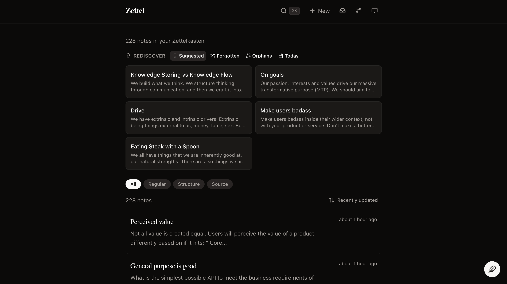

# Zettel-Web

A self-hostable Zettelkasten knowledge management app with AI-powered
semantic search. Capture notes in the web UI, find connections between
ideas using meaning-based search, and chat with your knowledge base.

> **Note:** the AWS *deployment* (Lambda, Terraform, SQS) was removed in
> v1.2.0 — Docker Compose is the only supported deployment. Bedrock
> remains available as an *embedding/chat provider* via ambient AWS
> credentials.

Built with ASP.NET Core, React, PostgreSQL + pgvector, and OpenAI or
Ollama (local, free).



---

## Table of Contents

- [Features](#features)
- [Deployment](#deployment)
  - [Docker Compose (self-hosted)](#docker-compose-self-hosted)
- [Configuration](#configuration)
  - [Required](#required)
  - [Embedding Provider](#embedding-provider)
  - [Chat LLM](#chat-llm)
  - [Research Agent](#research-agent-optional)
  - [Optional: Observability](#optional-observability)
  - [Search Tuning](#search-tuning)
- [Architecture](#architecture)
- [API Reference](#api-reference)
- [Running Tests](#running-tests)
- [Project Structure](#project-structure)
- [License](#license)

---

## Features

- **Semantic search** — Find notes by meaning using vector embeddings,
  with hybrid mode that combines full-text and semantic ranking
- **Zettelkasten workflow** — Permanent notes, fleeting notes (quick
  capture), structure notes (for organizing), and source notes (with
  bibliography metadata)
- **Knowledge graph** — Visual graph of note relationships and
  backlinks
- **Backlinks** — Wiki-style `[[Title]]` linking between notes with
  automatic backlink detection
- **Related notes** — AI-powered discovery of semantically similar
  notes and duplicate detection
- **URL enrichment** — Automatically fetches and extracts metadata from
  URLs found in notes
- **Import/export** — Import Notion-compatible markdown; export all
  notes as a ZIP with YAML front matter
- **Version history** — Tracks snapshots of note changes
- **Tag system** — Full-text autocomplete and filtering
- **Health monitoring** — `/health` endpoint with database and
  embedding API status
- **OpenTelemetry** — Built-in tracing and metrics instrumentation
- **Graceful degradation** — Falls back to full-text search if the
  embedding API is unavailable
- **Autonomous research agent** — Analyses KB gaps and rich clusters,
  generates targeted search queries, fetches from Brave Search and
  Arxiv, synthesises findings with an LLM instruction barrier, and
  queues results as fleeting notes for inbox triage

---

## Deployment

Zettel-Web is self-hosted via Docker Compose on a single server: the API
and UI are served by Traefik on a single port, backed by PostgreSQL with
pgvector. There is **no authentication built in** — run it on a trusted
LAN or put your own auth in front.

### Docker Compose (self-hosted)

The fastest way to run the full stack. Requires only Docker.

#### Quick Start

**1. Clone and configure**

```bash
git clone https://github.com/jameseastham/zettel-system.git
cd zettel-system
cp docker-compose.example.yml docker-compose.yml
```

Edit `docker-compose.yml` with your settings (see [Configuration](#configuration)
below). At minimum, choose an embedding provider.

**2. Start everything**

```bash
docker compose up -d
```

This starts four services behind Traefik on port 9010:

| Service         | Description                                                 |
| --------------- | ----------------------------------------------------------- |
| `traefik`       | Reverse proxy routing `/api/*` to backend, `/*` to frontend |
| `backend`       | ASP.NET Core API (port 8080 internal)                       |
| `frontend`      | React SPA                                                   |
| `db`            | PostgreSQL 16 with pgvector                                 |

The app is available at `http://localhost:9010`. The database is
persisted in `./data/postgres`.

**3. Verify**

```bash
curl http://localhost:9010/health
```

Should return `{"status":"Healthy",...}`.

#### Pre-Built Container Images

Container images are published to GitHub Container Registry on every
push to `main`:

```
ghcr.io/jameseastham/zettel-system/backend:latest
ghcr.io/jameseastham/zettel-system/frontend:latest
```

Tags available: `latest` (main branch), `sha-<commit>`, and semantic
versions (`v1.0.0`).

#### Building from Source

Requires [.NET 10 SDK](https://dot.net/download) and
[Node.js](https://nodejs.org/).

For local development with just the database:

```bash
docker compose -f docker-compose.dev.yml up -d  # starts PostgreSQL 16 on localhost:5432
dotnet run --project src/ZettelWeb
```

In a separate terminal for the frontend:

```bash
cd src/zettel-web-ui
npm install
npm run dev
```

---

## Configuration

All configuration is via environment variables (or `appsettings.json`
for local development). In Docker Compose, variables are set in the
`docker-compose.yml` file.

### Required

| Variable                               | Description                                                        |
| -------------------------------------- | ------------------------------------------------------------------ |
| `ConnectionStrings__DefaultConnection` | PostgreSQL connection string. Set automatically by docker-compose. |

### Embedding Provider

Choose between OpenAI (cloud) or Ollama (local, free).

#### Option A: Ollama (default, no API key needed)

Run [Ollama](https://ollama.ai) locally and pull a model:

```bash
ollama pull nomic-embed-text
```

```bash
EMBEDDING_PROVIDER=ollama
EMBEDDING_MODEL=nomic-embed-text
EMBEDDING_OLLAMA_URL=http://host.docker.internal:11434
```

If running Ollama on the same machine as Docker, the default
`host.docker.internal` URL works on macOS/Windows. On Linux, use
`http://172.17.0.1:11434` or add `--network=host`.

#### Option B: OpenAI

```bash
EMBEDDING_PROVIDER=openai
EMBEDDING_MODEL=text-embedding-3-large
EMBEDDING_API_KEY=sk-...
```

#### Option C: Amazon Bedrock

```bash
EMBEDDING_PROVIDER=bedrock
EMBEDDING_MODEL=amazon.titan-embed-text-v2:0
EMBEDDING_BEDROCK_REGION=eu-west-1
# Uses ambient AWS credentials (AWS_ACCESS_KEY_ID / AWS_SECRET_ACCESS_KEY)
```

#### All Embedding Options

| Variable                        | Default                  | Description                          |
| ------------------------------- | ------------------------ | ------------------------------------ |
| `Embedding__Provider`           | `ollama`                 | `openai`, `ollama`, or `bedrock`     |
| `Embedding__Model`              | `nomic-embed-text`       | Model name                           |
| `Embedding__Dimensions`         | `768`                    | Vector dimensions (must match model) |
| `Embedding__ApiKey`             | (empty)                  | OpenAI API key                       |
| `Embedding__OllamaUrl`          | `http://localhost:11434` | Ollama endpoint                      |
| `Embedding__MaxInputCharacters` | `4000`                   | Max text length before truncation    |
| `Embedding__MaxRetries`         | `3`                      | Retry count for failed embeddings    |
| `Embedding__BedrockRegion`       | (empty)                  | AWS region — Bedrock only            |

### Chat LLM

The chat assistant, research agent, and KB Health summarization share
a single chat/completion LLM, independent of the embedding provider.
The config keys live under the `ContentGeneration` section (kept from
the former content generation feature for backward compatibility).

#### Option A: Ollama (default)

Uses Ollama's OpenAI-compatible endpoint. Pull a chat model first:

```bash
ollama pull llama3.1
```

The URL defaults to the same value as `Embedding__OllamaUrl`
(`http://host.docker.internal:11434` in Docker), so a zero-config
setup alongside Ollama embeddings just works.

#### Option B: OpenAI

```bash
CONTENTGENERATION__PROVIDER=openai
CONTENTGENERATION__MODEL=gpt-4o
CONTENTGENERATION__APIKEY=sk-...
```

#### Option C: Amazon Bedrock

```bash
CONTENTGENERATION__PROVIDER=bedrock
CONTENTGENERATION__MODEL=anthropic.claude-3-5-sonnet-20241022-v2:0
CONTENTGENERATION__REGION=eu-west-1
# Uses ambient AWS credentials (AWS_ACCESS_KEY_ID / AWS_SECRET_ACCESS_KEY)
```

| Variable                        | Default              | Description                                |
| ------------------------------- | -------------------- | ------------------------------------------ |
| `ContentGeneration__Provider`   | `ollama`             | `ollama`, `openai`, or `bedrock`           |
| `ContentGeneration__Model`       | `llama3.1`           | Model identifier                           |
| `ContentGeneration__ApiKey`     | (empty)              | OpenAI API key — required for `openai`     |
| `ContentGeneration__OllamaUrl`  | = `Embedding__OllamaUrl` | Ollama endpoint — `ollama` provider only |
| `ContentGeneration__Region`     | (empty)              | AWS region — `bedrock` provider only      |

### Research Agent (optional)

The autonomous research agent analyses your knowledge base, generates
targeted search queries, and queues findings for your review. It requires
a [Brave Search API key](https://brave.com/search/api/) for web search;
Arxiv search requires no key.

```bash
Research__BraveSearch__ApiKey=BSA...
```

The agent is triggered manually from the Knowledge Health dashboard or
via `POST /api/research/trigger`. Findings appear at `/research` in the
UI for accept (→ fleeting note) or dismiss.

| Variable                              | Default | Description                                                          |
| ------------------------------------- | ------- | -------------------------------------------------------------------- |
| `Research__BraveSearch__ApiKey`       | (empty) | Brave Search API key. Web search is skipped if empty.                |
| `Research__MaxFindingsPerRun`         | `5`     | Maximum findings created per research run                            |
| `Research__DeduplicationThreshold`   | `0.85`  | Cosine similarity threshold — results above this are skipped as near-duplicates of existing notes |

The agent reuses the same LLM provider configuration (the
`ContentGeneration` section keys) for agenda generation and synthesis.
No additional LLM configuration is needed.

### Optional: Observability

| Variable         | Description                                                          |
| ---------------- | -------------------------------------------------------------------- |
| `Otel__Endpoint` | OpenTelemetry collector endpoint (e.g. `http://otel-collector:4317`) |

### Search Tuning

| Variable                    | Default | Description                                  |
| --------------------------- | ------- | -------------------------------------------- |
| `Search__SemanticWeight`    | `0.7`   | Weight for semantic scores in hybrid search  |
| `Search__FullTextWeight`    | `0.3`   | Weight for full-text scores in hybrid search |
| `Search__MinimumSimilarity` | `0.5`   | Minimum cosine similarity threshold          |

---

## Architecture

### Docker Compose

```
┌─────────┐     ┌──────────┐     ┌──────────────────┐
│ React   │────▶│ Traefik  │────▶│ ASP.NET Core API │
│ Frontend│     │ (proxy)  │     │                  │
└─────────┘     └──────────┘     │ Controllers      │
                                 │ Services         │
                                 │ Background       │
                                 │  Workers         │
                                 └────────┬─────────┘
                                          │
                    ┌─────────────────────┼──────────────────┐
                    │                     │                  │
               ┌────▼─────┐    ┌─────────▼──┐   ┌──────────▼──────┐
               │PostgreSQL │    │ Embedding  │   │ Chat LLM        │
               │+ pgvector │    │ (OpenAI /  │   │ (OpenAI/Ollama) │
               └───────────┘    │  Ollama)   │   └─────────────────┘
                                └────────────┘
```

## API Reference

### Notes

| Method   | Endpoint                        | Description                                 |
| -------- | ------------------------------- | ------------------------------------------- |
| `POST`   | `/api/notes`                    | Create a note                               |
| `GET`    | `/api/notes`                    | List notes (supports pagination, filtering) |
| `GET`    | `/api/notes/{id}`               | Get a note by ID                            |
| `PUT`    | `/api/notes/{id}`               | Update a note                               |
| `DELETE` | `/api/notes/{id}`               | Delete a note                               |
| `POST`   | `/api/notes/check-duplicate`    | Check for duplicate content                 |
| `POST`   | `/api/notes/re-embed`           | Re-embed all notes                          |
| `GET`    | `/api/notes/{id}/backlinks`     | Get wiki-style backlinks                    |
| `GET`    | `/api/notes/{id}/versions`      | Get version history                         |
| `POST`   | `/api/notes/{id}/promote`       | Convert fleeting to permanent               |
| `POST`   | `/api/notes/{fleetingId}/merge` | Merge fleeting into permanent               |

### Search

| Method | Endpoint                              | Description              |
| ------ | ------------------------------------- | ------------------------ |
| `GET`  | `/api/search?q={query}`               | Hybrid search (default)  |
| `GET`  | `/api/search?q={query}&type=fulltext` | Full-text only           |
| `GET`  | `/api/search?q={query}&type=semantic` | Semantic only            |
| `GET`  | `/api/search/{noteId}/related`        | Find related notes       |
| `GET`  | `/api/search/discover`                | Discover unrelated notes |

### Import / Export

| Method | Endpoint      | Description                        |
| ------ | ------------- | ---------------------------------- |
| `POST` | `/api/import` | Import markdown files (JSON array) |
| `GET`  | `/api/export` | Download all notes as ZIP          |


### Knowledge Base Health

| Method | Endpoint                                 | Description                                    |
| ------ | ---------------------------------------- | ---------------------------------------------- |
| `GET`  | `/api/kb-health/overview`                | Scorecard, orphans, clusters, unused seeds     |
| `GET`  | `/api/kb-health/orphan/{id}/suggestions` | Semantic connection suggestions for an orphan  |
| `POST` | `/api/kb-health/orphan/{id}/link`        | Insert a `[[wikilink]]` into an orphan note    |

### Research Agent

| Method | Endpoint                                      | Description                                                           |
| ------ | --------------------------------------------- | --------------------------------------------------------------------- |
| `POST` | `/api/research/trigger`                       | Analyse KB and generate a research agenda (returns agenda for review) |
| `POST` | `/api/research/agenda/{agendaId}/approve`     | Approve agenda and start execution (202 — runs in background)         |
| `GET`  | `/api/research/findings`                      | List pending findings awaiting review                                 |
| `POST` | `/api/research/findings/{findingId}/accept`   | Accept a finding — creates a fleeting note                            |
| `POST` | `/api/research/findings/{findingId}/dismiss`  | Dismiss a finding                                                     |

### Other

| Method | Endpoint                | Description          |
| ------ | ----------------------- | -------------------- |
| `GET`  | `/api/tags?q={prefix}`  | Autocomplete tags    |
| `GET`  | `/api/graph`            | Knowledge graph data |
| `GET`  | `/api/discovery/random` | Random notes         |
| `GET`  | `/health`               | Service health check |

---

## Running Tests

```bash
dotnet test
```

Unit tests use in-memory databases and require no external services.
Integration tests spin up a real PostgreSQL container via
[Testcontainers](https://testcontainers.com/) — Docker must be running.

---

## Project Structure

```
zettel-system/
  src/
    ZettelWeb/           # ASP.NET Core Web API
    ZettelWeb.Tests/     # xUnit test project
    zettel-web-ui/       # React frontend (Vite + Tailwind)
  docs/                  # Design docs, ADRs, compound knowledge docs
  docker-compose.example.yml  # Full stack (Traefik + backend + frontend + DB)
  docker-compose.dev.yml      # Dev database only (PostgreSQL 16 + pgvector)
```

---

## License

MIT
